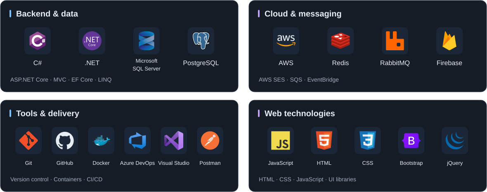
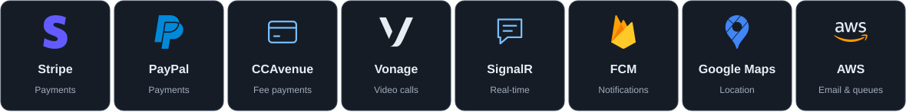
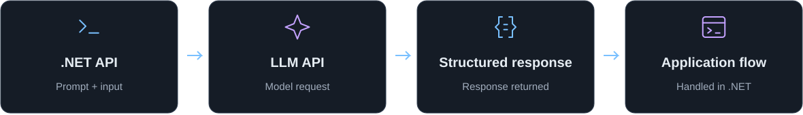

<picture>
  <source media="(prefers-color-scheme: dark)" srcset="./dark.svg">
  <source media="(prefers-color-scheme: light)" srcset="./light.svg">
  
</picture>

  
  

I’m **Rahul**, a Software Engineer working with **.NET, cloud services, and AI integrations**. My experience spans legal technology, healthcare, employee management, and education—from building application features to connecting services and supporting software in production.

## 🧰 Technology & tools

<picture>
  <source media="(prefers-color-scheme: dark)" srcset="./assets/stack-dark.svg">
  <source media="(prefers-color-scheme: light)" srcset="./assets/stack-light.svg">
  
</picture>

**Delivery:** Azure DevOps and team CI/CD workflows at work; Docker and CI/CD in personal projects.

## 🧩 Projects I’ve worked on

<table>
<tr>
<td width="50%" valign="top">

<h3>eDiscovery &amp; FOIA platform</h3>

Backend modules for document and email ingestion, request workflows, multilingual processing, background services, and database performance.

<code>.NET</code> <code>SQL Server / PostgreSQL</code> <code>AWS</code>

Professional work · Casepoint

</td>
<td width="50%" valign="top">

<h3>VCDoctor · Telehealth</h3>

Web and mobile APIs with one-to-one messaging, call notifications, payments, and video-consultation integrations.

<code>ASP.NET MVC</code> <code>SignalR</code> <code>Firebase</code>

Client project · Vision Infotech

</td>
</tr>
<tr>
<td width="50%" valign="top">

<h3>HRMS · Employee management</h3>

Employee-management and payroll functionality through .NET Core APIs for an Angular frontend, with SQL optimization and server-side pagination.

<code>.NET Core Web API</code> <code>SQL Server</code> <code>Angular</code>

Professional work · Vision Infotech

</td>
<td width="50%" valign="top">

<h3>Zibma School ERP</h3>

School-specific features, role-based reports, fee payments, location services, and attendance and announcement notifications across a shared application.

<code>ASP.NET</code> <code>.NET Core</code> <code>SQL Server</code>

Professional work · Zibma Infotech

</td>
</tr>
</table>

## 🔌 Services I’ve integrated

<picture>
  <source media="(prefers-color-scheme: dark)" srcset="./assets/integrations-dark.svg">
  <source media="(prefers-color-scheme: light)" srcset="./assets/integrations-light.svg">
  
</picture>

| What the application needed | Integrations |
| --- | --- |
| Payments and school fees | Stripe, PayPal, CCAvenue |
| Real-time messaging and video consultations | SignalR, Vonage |
| Call alerts, attendance and announcement notifications | Firebase Cloud Messaging |
| Location features | Google Maps |
| Email and asynchronous processing | AWS SES, SQS, EventBridge |

## 🤖 AI integrations & development workflow

I integrate LLM APIs into .NET application flows: send a prompt with input, receive a structured response, and handle the result inside the API.

<picture>
  <source media="(prefers-color-scheme: dark)" srcset="./assets/ai-flow-dark.svg">
  <source media="(prefers-color-scheme: light)" srcset="./assets/ai-flow-light.svg">
  
</picture>

**AI-assisted development:** Claude-based coding as part of my development and SDLC workflow, alongside GitHub Copilot.

<picture>
  <source media="(prefers-color-scheme: dark)" srcset="./assets/ai-tools-dark.svg">
  <source media="(prefers-color-scheme: light)" srcset="./assets/ai-tools-light.svg">
  
</picture>

---

[Explore my GitHub](https://github.com/004-rahul) · [Connect on LinkedIn](https://www.linkedin.com/in/rahul-patel-889459229)

<!-- Brand-icon sources and licenses are included in assets/CREDITS.md. -->
