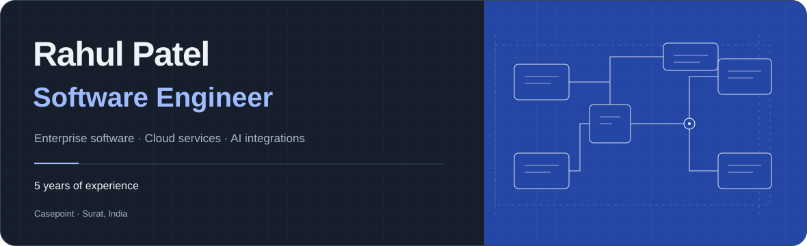
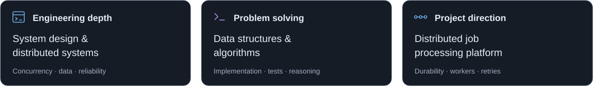
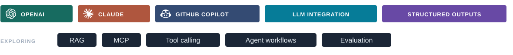
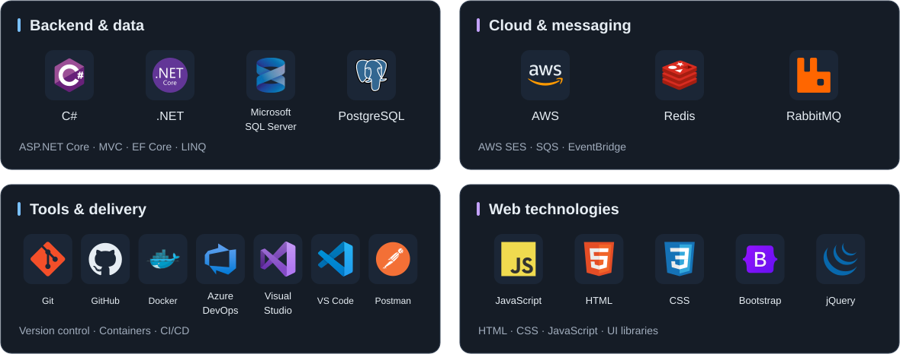
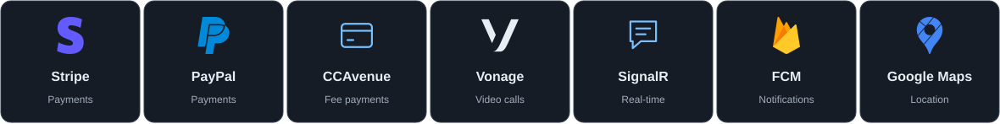
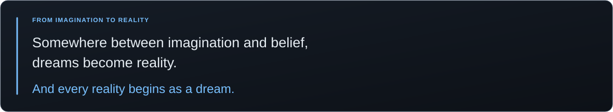
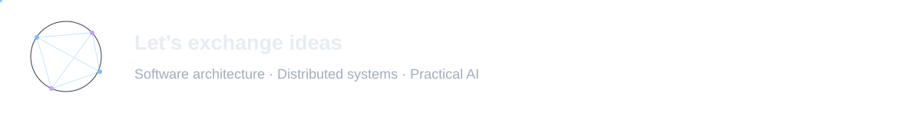

<picture>
  <source media="(prefers-color-scheme: dark)" srcset="./assets/hero-blueprint-studio-486e654b7c-dark.svg">
  <source media="(prefers-color-scheme: light)" srcset="./assets/hero-blueprint-studio-522b639ff1-light.svg">
  
</picture>

  
  

**I’m Rahul Patel, a Software Engineer with five years of experience building and maintaining enterprise applications.** I work across backend services, business workflows, and integrations, with a focus on reliable, maintainable software.

My experience covers requirements, implementation, testing, code review, database performance, and production support. I collaborate with clients, product teams, and QA, and also integrate LLM capabilities into application workflows. Alongside delivery work, I’m deepening my knowledge of architecture and distributed systems.

## 🧭 Current focus

<picture>
  <source media="(prefers-color-scheme: dark)" srcset="./assets/current-focus-dark.svg">
  <source media="(prefers-color-scheme: light)" srcset="./assets/current-focus-light.svg">
  
</picture>

## 🧰 Tech stack

### 🤖 AI & intelligent workflows

<picture>
  <source media="(prefers-color-scheme: dark)" srcset="./assets/ai-focus-dark.svg">
  <source media="(prefers-color-scheme: light)" srcset="./assets/ai-focus-light.svg">
  
</picture>

### ⚙️ Development & infrastructure

<picture>
  <source media="(prefers-color-scheme: dark)" srcset="./assets/stack-dark.svg">
  <source media="(prefers-color-scheme: light)" srcset="./assets/stack-light.svg">
  
</picture>

## 🧩 Domains I’ve worked in

<table>
<tr>
<td width="100%" valign="top">
<h3> eDiscovery &amp; FOIA platform</h3>

Enterprise legal technology supporting eDiscovery and FOIA operations for U.S. government agencies and organizations. My work centers on eDiscovery: high-volume document and email ingestion, multilingual processing, and background services that move content through processing workflows. I contribute to backend modernization and database performance to support reliable processing across large document collections.

Professional work · Casepoint

</td>
</tr>
<tr>
<td width="100%" valign="top">
<h3> Healthcare</h3>

Telehealth software connecting patients and clinicians across web and mobile experiences. I developed backend APIs and integrated real-time one-to-one communication, video consultations, payment processing, and multi-device call notifications. The work brought these services together within the consultation workflow, alongside ongoing API enhancements and production support.

Client project · Vision Infotech

</td>
</tr>
<tr>
<td width="100%" valign="top">
<h3> Employee management</h3>

Employee-management and payroll software supporting day-to-day HR operations and business workflows. I worked from client requirements through database design, backend APIs, and release delivery, translating operational needs into application features. My contributions also included optimizing stored procedures and data retrieval, implementing server-side pagination, and resolving production issues as requirements evolved.

Professional work · Vision Infotech

</td>
</tr>
<tr>
<td width="100%" valign="top">
<h3> Education system / School ERP</h3>

A shared school ERP covering academic, financial, and campus operations across multiple institutions. Its scope includes role-based staff and student management, attendance, transportation, library services, online classes and exams, fee management, and extensive reporting. I contributed institution-specific features, backend APIs, reports, payment and notification integrations, and performance improvements within the shared application.

Professional work · Zibma Infotech

</td>
</tr>
</table>

## 🔌 Services I’ve integrated

<picture>
  <source media="(prefers-color-scheme: dark)" srcset="./assets/integrations-dark.svg">
  <source media="(prefers-color-scheme: light)" srcset="./assets/integrations-light.svg">
  
</picture>

---

## 💬 What drives my work

<picture>
  <source media="(prefers-color-scheme: dark)" srcset="./assets/principles-dark.svg">
  <source media="(prefers-color-scheme: light)" srcset="./assets/principles-light.svg">
  
</picture>

<picture>
  <source media="(prefers-color-scheme: dark)" srcset="./assets/connect-dark.svg">
  <source media="(prefers-color-scheme: light)" srcset="./assets/connect-light.svg">
  
</picture>

[Explore my GitHub](https://github.com/004-rahul) · [Connect on LinkedIn](https://www.linkedin.com/in/rahul-patel-889459229)

<!-- Brand-icon sources and licenses are included in assets/CREDITS.md. -->
